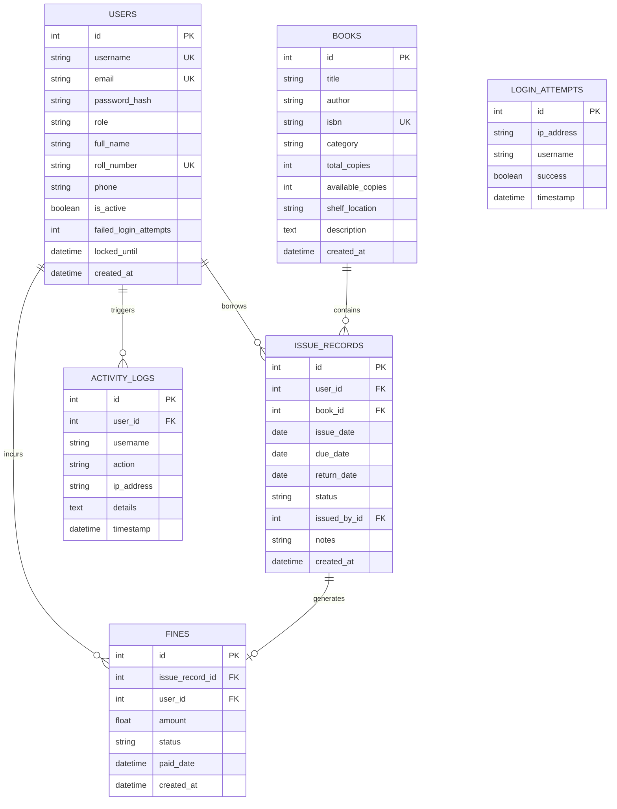

# Granthify – Secure Library Management System Using Python & Flask

> **Academic Project:** College Minor Project – B.Tech Cyber Security (2nd Year)  
> **Framework & Language:** Python 3.12, Flask 3.1, Flask-SQLAlchemy, Flask-Login, Flask-Bcrypt, Flask-WTF, Bootstrap 5.3  
> **Database:** SQLite 3 (ORM Parameterized)  
> **Status:** Production-Ready / Minor Project Evaluated  

---

## Table of Contents
1. [Project Overview & Architecture](#1-project-overview--architecture)
2. [Folder Structure](#2-folder-structure)
3. [Technology Stack](#3-technology-stack)
4. [Cybersecurity Architecture & Defense In Depth](#4-cybersecurity-architecture--defense-in-depth)
5. [Database Schema & Relationships](#5-database-schema--relationships)
6. [User Roles & Functional Specifications](#6-user-roles--functional-specifications)
7. [Installation & Setup Instructions](#7-installation--setup-instructions)
8. [Default Demonstration Credentials](#8-default-demonstration-credentials)
9. [Automated Testing & Security Validation](#9-automated-testing--security-validation)
10. [College Project Report Outline](#10-college-project-report-outline)
11. [Viva Voce Preparation (Q&A)](#11-viva-voce-preparation-qa)
12. [Future Improvements & Enhancements](#12-future-improvements--enhancements)

---

## 1. Project Overview & Architecture

**Granthify** is an enterprise-grade, cyber-hardened, web-based Library Management System designed specifically to bridge academic library automation with modern offensive and defensive cybersecurity standards.

### Architectural Pattern: Application Factory & Modular Blueprints
The application employs the **Flask Application Factory Pattern** (`create_app`) combined with modular **Blueprints** (`auth`, `admin`, `student`, `main`). This separates presentation, business logic, authorization enforcement, and database operations into decoupled layers.

```
+-------------------------------------------------------------------------+
|                              CLIENT TIER                                |
|          Web Browser (HTML5 / Bootstrap 5 / Responsive UI)              |
+------------------------------------+------------------------------------+
                                     |  HTTPS Requests + CSRF Tokens
+------------------------------------v------------------------------------+
|                         APPLICATION GATEWAY / MIDDLEWARE               |
|  - Session Hardening (HTTPOnly, SameSite='Lax', 60m expiry)             |
|  - CSRF Protection (Flask-WTF token validator)                          |
|  - IP Extraction & Sanitization                                         |
+------------------------------------+------------------------------------+
                                     |
+------------------------------------v------------------------------------+
|                   ROLE-BASED ACCESS CONTROL (RBAC) LAYER                |
|  - @login_required (Flask-Login)                                        |
|  - @admin_required (Privilege validator -> 403 Forbidden on violation)  |
|  - @student_required (Student isolation)                                |
+------------------------------------+------------------------------------+
                                     |
+------------------------------------v------------------------------------+
|                         MODULAR BLUEPRINT SERVICES                      |
|   [auth_bp]            [admin_bp]            [student_bp]      [main_bp]|
|   - Bcrypt Hashing     - Inventory CRUD      - Catalog Search  - Landing|
|   - Account Lockout    - Student Mgmt        - Book Requests   - Catalog|
|   - Session Fixation   - Issue & Returns     - Active Loans             |
|                        - Fine Enforcement    - Fine Tracking            |
+------------------------------------+------------------------------------+
                                     |
+------------------------------------v------------------------------------+
|                 PERSISTENCE TIER (SQLAlchemy ORM)                       |
|   - Parameterized queries (Complete SQL Injection Immunity)            |
|   - Relational Tables: users, books, issue_records, fines,              |
|                        activity_logs, login_attempts                    |
+-------------------------------------------------------------------------+
```

---

## 2. Folder Structure

```
library management system/
│
├── .env                     # Local environment secrets and configuration
├── .env.example             # Template environment file for deployment
├── config.py                # Environment configurations (Dev, Test, Prod)
├── requirements.txt         # Pinned Python package dependencies
├── run.py                   # Application entry point script
├── seed.py                  # Database initializer and demo data seeder
├── test_app.py              # Automated PyTest test suite (9 security tests)
├── README.md                # Project documentation and viva guide
│
└── app/
    ├── __init__.py          # App factory (create_app), extension setup, error handlers
    ├── models.py            # Relational database models (User, Book, Issue, Fine, Log)
    ├── forms.py             # WTForms input validators with regex and CSRF protection
    ├── decorators.py        # RBAC decorators (@admin_required, @student_required)
    ├── utils.py             # IP capture, audit logging, fine synchronization, sanitization
    │
    ├── routes/
    │   ├── __init__.py
    │   ├── auth.py          # Authentication, registration, logout, lockout logic
    │   ├── admin.py         # Admin dashboard, book management, approvals, fines, logs
    │   ├── student.py       # Student dashboard, catalog search, book requests, my fines
    │   └── main.py          # Public index, public catalog, landing page
    │
    ├── static/
    │   ├── css/
    │   │   └── style.css    # Custom cybersecurity dark/blue theme stylesheet
    │   └── js/
    │       └── main.js      # Auto-dismissing alerts, instant search, toggle password
    │
    └── templates/
        ├── base.html        # Master layout with responsive sidebar and navigation
        ├── index.html       # Public landing page with cybersecurity highlights
        ├── 403.html         # Custom 403 Forbidden error template
        ├── 404.html         # Custom 404 Not Found error template
        ├── 500.html         # Custom 500 Internal Error template (suppressed traces)
        │
        ├── auth/
        │   ├── login.html           # Login form with rate-limit warnings
        │   ├── register.html        # Student registration with password policies
        │   └── change_password.html # Authenticated password update form
        │
        ├── admin/
        │   ├── dashboard.html       # Metrics KPI cards, overdue alerts, audit feeds
        │   ├── books.html           # Book catalog table with live search and actions
        │   ├── book_form.html       # Add / Edit book form
        │   ├── students.html        # Student account status, toggle, unlock buttons
        │   ├── issue_return.html    # Circulation desk (direct issue, approve, return)
        │   ├── fines.html           # Penalty tracking, payment records, sync
        │   └── activity_logs.html   # Forensics audit trail filterable by action
        │
        └── student/
            ├── dashboard.html       # Student loan counter, due dates, fee warnings
            ├── catalog.html         # Book catalog with search filters & request buttons
            ├── my_books.html        # Active borrowed books and pending reservations
            ├── history.html         # Historical returned loans archive
            └── my_fines.html        # Itemized fine breakdown & payment statuses
```

---

## 3. Technology Stack

| Layer | Component | Description / Role |
| :--- | :--- | :--- |
| **Backend Language** | Python 3.12 | Core programming language |
| **Web Framework** | Flask 3.1 | Lightweight, high-performance WSGI web application framework |
| **ORM & Database** | Flask-SQLAlchemy / SQLite 3 | Object Relational Mapper preventing SQL injection via parameterized statements |
| **Authentication** | Flask-Login 0.6 | Session-based user authentication and user loader management |
| **Password Hashing** | Flask-Bcrypt (Bcrypt 5.0) | Blowfish-based adaptive key derivation function with random salt |
| **Form & CSRF** | Flask-WTF / WTForms | Server-side validation, length checking, regex, and Anti-CSRF tokens |
| **Frontend Styling** | Bootstrap 5.3 + Custom CSS | Responsive layout, card statistics, navigation sidebar, badges |
| **Icons** | Bootstrap Icons 1.11 | Modern iconography |
| **Automated Testing** | PyTest 9.2 | Unit testing and RBAC security regression verification |

---

## 4. Cybersecurity Architecture & Defense In Depth

Granthify was engineered to satisfy standard **OWASP Top 10** defensive controls:

### 1. Adaptive Password Hashing (Bcrypt)
- Passwords are never stored in plaintext.
- We utilize `Flask-Bcrypt` with an automatic salt and a work factor of 12 rounds.
- Resistant against rainbow table attacks and specialized GPU brute-force hardware.
- Code implementation: [`app/models.py`](file:///c:/Users/harsh/Downloads/library%20management%20system/app/models.py#L38-L46)

### 2. Role-Based Access Control (RBAC)
- Strict separation of privileges between `admin` and `student` roles.
- Enforced at route level using custom Python decorators (`@admin_required`, `@student_required`).
- Unauthorized requests immediately terminate with an HTTP `403 Forbidden` status code, preventing privilege escalation.
- Code implementation: [`app/decorators.py`](file:///c:/Users/harsh/Downloads/library%20management%20system/app/decorators.py#L11-L43)

### 3. SQL Injection (SQLi) Immunity
- All database operations are executed via SQLAlchemy Object Relational Mapping (ORM).
- SQL statements are compiled into parameterized queries where user inputs are treated exclusively as literal parameters rather than executable SQL syntax.
- Zero raw string concatenation (`f"SELECT * FROM ... {input}"`) exists in the codebase.
- Verified with automated SQLi payloads in [`test_app.py`](file:///c:/Users/harsh/Downloads/library%20management%20system/test_app.py#L182-L198).

### 4. Brute-Force Defense & Account Lockout
- Authentication attempts are monitored in `LoginAttempt` and tracked on the `User` model (`failed_login_attempts`).
- When a user incurs **5 consecutive failed password attempts**, their account is automatically locked for **15 minutes** (`locked_until`).
- Even with the correct password, authentication is denied until the lockout timer expires or an administrator manually unlocks the account.
- Code implementation: [`app/routes/auth.py`](file:///c:/Users/harsh/Downloads/library%20management%20system/app/routes/auth.py#L42-L115)

### 5. Cross-Site Request Forgery (CSRF) Protection
- State-changing HTTP requests (`POST`) require a cryptographically signed CSRF token generated by `Flask-WTF`.
- Attackers on external malicious websites cannot forge authenticated requests on behalf of an active Granthify user.

### 6. Session Management Hardening & Fixation Prevention
- `SESSION_COOKIE_HTTPONLY = True`: Blocks client-side JavaScript from accessing session cookies via `document.cookie` (Mitigates XSS session hijacking).
- `SESSION_COOKIE_SAMESITE = 'Lax'`: Ensures session cookies are withheld during cross-site requests.
- `session.clear()` is called prior to `login_user()` to destroy pre-authentication sessions and prevent **Session Fixation attacks**.
- Session lifetime is capped at 60 minutes (`PERMANENT_SESSION_LIFETIME = timedelta(minutes=60)`).

### 7. Input Validation & Sanitization
- Form inputs are validated with WTForms for data type, minimum and maximum lengths, and regex constraints.
- Custom sanitization strips dangerous HTML tags and script event handlers (`<script>`, `onload=`, etc.) to mitigate Stored and Reflected Cross-Site Scripting (XSS).

### 8. Immutable Security Audit Trail
- Administrative and security-critical actions (logins, book creations, deletions, loan approvals, returns, account locks/unlocks) are recorded in the `activity_logs` table.
- Captures: `user_id`, `username`, `action`, `ip_address`, `details`, and `timestamp`.
- Essential for forensics and non-repudiation.

### 9. Information Disclosure Prevention (Safe Error Handling)
- Custom error handlers for `403 Forbidden`, `404 Not Found`, and `500 Internal Server Error`.
- Debug stack traces and database schema errors are suppressed in production templates to prevent system reconnaissance by malicious actors.

### 10. Environment Variable Isolation
- Sensitive secrets (like `SECRET_KEY`, database credentials, and loan policy constants) are stored in `.env` files rather than hardcoded in the codebase.

---

## 5. Database Schema & Relationships



---

## 6. User Roles & Functional Specifications

### Administrator Capabilities:
1. **Secure Admin Authentication:** Protected login with brute-force resistance.
2. **Book Inventory Management:** Full CRUD (Create, Read, Update, Delete) with validation against deleting actively borrowed books.
3. **Student Account Management:** View student roster, active loans, outstanding dues, toggle activation status, and unlock accounts locked by brute-force protection.
4. **Circulation Desk (Issue & Return):**
   - Approve or reject pending student reservation requests.
   - Issue books directly to active students with customized loan durations.
   - Automatically decrements available stock upon issue.
   - Accept returns and automatically restore available book copies.
5. **Automated Late Fine Management:**
   - Evaluates overdue loans ($Rate = \text{₹5.00/day}$).
   - Records late penalty records in the database.
   - Marks fines as settled/paid.
6. **Analytics & Audit Dashboards:**
   - Real-time KPI counters (Total Books, Available Copies, Active Loans, Overdue Issues, Unpaid Fines).
   - Forensic audit trail with client IP tracking and action filters.

### Student Capabilities:
1. **Self-Registration & Authentication:** Sign up using college roll number and college email with strict password complexity requirements.
2. **Catalog Exploration & Multi-Filter Search:** Filter books by Title, Author, ISBN, Category, and Availability status.
3. **Book Reservation Requests:** Request books from catalog (restricted to maximum 3 active books/requests and gated against high unpaid fines).
4. **Active Loans Tracking:** Real-time visibility into borrowed books, return due dates, and remaining countdown days.
5. **Borrowing History:** Archive of completed returns and past requests.
6. **Fine Statement:** Clear overview of assessed penalties and payment statuses.

---

## 7. Installation & Setup Instructions

### Prerequisites
- Python 3.10, 3.11, or 3.12 installed on your machine.
- Git (optional, for version control).

### Step 1: Open Terminal / PowerShell in Project Directory
```powershell
cd "c:\Users\harsh\Downloads\library management system"
```

### Step 2: Create and Activate a Virtual Environment (Recommended)
```powershell
# Create virtual environment
python -m venv venv

# Activate virtual environment (Windows PowerShell)
.\venv\Scripts\Activate.ps1

# (On Linux / macOS use: source venv/bin/activate)
```

### Step 3: Install Required Dependencies
```powershell
pip install -r requirements.txt
```

### Step 4: Configure Environment Variables
Verify that the `.env` file is present in the root folder. If creating from scratch:
```powershell
copy .env.example .env
```

### Step 5: Initialize and Seed the Database
Run the seed script to create all SQLite tables, generate hashed accounts, and populate academic textbooks:
```powershell
python seed.py
```

### Step 6: Launch the Web Application
```powershell
python run.py
```
Open your web browser and navigate to:
```
http://127.0.0.1:5000
```

---

## 8. Default Demonstration Credentials

| Role | Username | Password | Purpose |
| :--- | :--- | :--- | :--- |
| **Administrator** | `admin` | `AdminPassword123!` | Full administrative control, circulation desk, logs |
| **Student (Demo 1)** | `cyber_student` | `StudentPass123!` | Sample student with 1 active loan and 1 pending request |
| **Student (Demo 2)** | `rohan_verma` | `StudentPass123!` | Clean student account for new borrowing tests |

---

## 9. Automated Testing & Security Validation

Granthify includes an automated PyTest test suite testing RBAC boundaries, brute force lockout, ORM immunity, and fine calculation.

To execute the test suite:
```powershell
pytest test_app.py -v
```

### Test Suite Execution Output:
```text
test_app.py::test_password_hashing PASSED                 [ 11%]
test_app.py::test_account_lockout PASSED                  [ 22%]
test_app.py::test_unauthenticated_access_blocked PASSED   [ 33%]
test_app.py::test_student_cannot_access_admin_portal PASSED [ 44%]
test_app.py::test_admin_cannot_access_student_portal PASSED [ 55%]
test_app.py::test_admin_can_access_admin_dashboard PASSED [ 66%]
test_app.py::test_book_issue_and_return_lifecycle PASSED  [ 77%]
test_app.py::test_overdue_fine_calculation PASSED         [ 88%]
test_app.py::test_sql_injection_resilience PASSED         [100%]

======================== 9 passed in 6.15s ========================
```

---

## 10. College Project Report Outline

You can directly structure your B.Tech Minor Project Report using this outline:

1. **Title Page:** Granthify – Secure Library Management System Using Python & Flask
2. **Certificate of Authenticity & Declaration**
3. **Acknowledgement & Abstract**
4. **Chapter 1: Introduction**
   - 1.1 Problem Statement in Traditional Library Systems
   - 1.2 Motivation: Integrating Cybersecurity into Web Applications
   - 1.3 Project Objectives & Scope
5. **Chapter 2: Literature Survey & Security Threats**
   - 2.1 Common Vulnerabilities in Web Portals (OWASP Top 10)
   - 2.2 SQL Injection, CSRF, and Weak Authentication Case Studies
   - 2.3 Comparative Analysis with Existing Library Systems (Koha, LibSys)
6. **Chapter 3: System Requirement Analysis**
   - 3.1 Functional Requirements (Admin vs. Student Roles)
   - 3.2 Non-Functional Requirements (Performance, Security, Reliability)
   - 3.3 Hardware & Software Prerequisites
7. **Chapter 4: System Architecture & Database Design**
   - 4.1 Multi-tier Modular Architecture
   - 4.2 Entity-Relationship (ER) Diagram
   - 4.3 Data Dictionary and Table Structures
8. **Chapter 5: Implementation & Cybersecurity Controls**
   - 5.1 Bcrypt Password Hashing & Key Derivation
   - 5.2 Role-Based Access Control (RBAC) via Decorators
   - 5.3 Anti-Brute-Force Account Lockout Algorithm
   - 5.4 Cross-Site Request Forgery (CSRF) Mitigation
   - 5.5 Forensic Audit Trail Logging
9. **Chapter 6: Testing & Security Verification**
   - 6.1 Unit Testing with PyTest
   - 6.2 Penetration Testing Simulation (SQLi Injection Attempts, Privilege Escalation)
   - 6.3 Test Cases & Results Matrix
10. **Chapter 7: Results, Conclusion & Future Scope**
    - 7.1 System Screenshots & Workflow
    - 7.2 Security Audit Summary
    - 7.3 Limitations & Future Enhancements
11. **References & Bibliography**

---

## 11. Viva Voce Preparation (Q&A)

### Q1: Why did you choose Bcrypt over MD5 or SHA-256 for password hashing?
**Answer:** MD5 and standard SHA-256 are fast general-purpose cryptographic hash functions designed for data integrity. Because they are fast, an attacker using modern GPU rigs can compute billions of hashes per second, making dictionary and brute-force attacks trivial. **Bcrypt** is an adaptive password hashing function based on the Blowfish cipher. It includes an automatic salt (preventing rainbow table attacks) and a configurable **work factor (cost factor)** that makes each hash computationally expensive, neutralizing GPU-accelerated cracking.

### Q2: How does your application prevent SQL Injection?
**Answer:** In Granthify, we use **SQLAlchemy ORM**. Instead of constructing dynamic SQL queries by interpolating raw Python strings, SQLAlchemy uses **parameterized queries** (prepared statements). The SQL query structure is sent to the database engine first, and user inputs are passed separately as literal data parameters. The database parser never executes user data as SQL commands, rendering injection attacks like `' OR '1'='1` harmless text strings.

### Q3: What is Cross-Site Request Forgery (CSRF) and how is it mitigated here?
**Answer:** CSRF is an attack where an authenticated user is tricked by a malicious site into submitting unwanted commands to a vulnerable web application where they are already logged in. Granthify mitigates this using `Flask-WTF`'s `CSRFProtect`. Every state-changing form includes a cryptographically signed, unpredictable token stored in the user's session. The server validates that the submitted token matches the session token; since an external site cannot read cross-origin session tokens due to the Same-Origin Policy, forged requests fail validation.

### Q4: How does your Account Lockout mechanism work?
**Answer:** Each time a user fails an authentication attempt, `User.failed_login_attempts` is incremented and logged in `LoginAttempt`. If the counter reaches `5`, the system sets `User.locked_until = now + 15 minutes`. During this window, all authentication attempts are rejected immediately, even if the correct password is entered. Upon a successful login or an explicit administrative unlock, the counter and timestamp are reset to zero.

### Q5: What is Session Fixation and how does Granthify prevent it?
**Answer:** Session Fixation occurs when an attacker forces a victim to use a known session identifier, so that once the victim logs in, the attacker can hijack the authenticated session. In Granthify's `auth.py`, we execute `session.clear()` immediately upon successful credential verification before calling `login_user()`. This invalidates any pre-authentication session cookie and generates a fresh session identifier for the authenticated state.

### Q6: What does the HTTPOnly flag on session cookies accomplish?
**Answer:** By configuring `SESSION_COOKIE_HTTPONLY = True`, the web browser forbids client-side scripts (such as JavaScript) from accessing the session cookie via `document.cookie`. Even if an attacker were to discover an XSS vulnerability on the site, they cannot directly extract the user's session cookie to hijack their session.

---

## 12. Future Improvements & Enhancements

For future expansion or a Final Year Major Project:
1. **Multi-Factor Authentication (MFA / 2FA):** Integrate TOTP (Time-Based One-Time Password) using Google Authenticator / Authy.
2. **Barcode / QR Code Book Scanner:** Implement webcam-based ISBN barcode scanning for rapid circulation processing.
3. **Automated Email Overdue Notifications:** Background task scheduler (e.g. Celery / Redis) sending automated email reminders 2 days prior to the due date.
4. **Online Fine Payment Gateway:** Integrate Razorpay or Stripe sandbox for digital student fine clearance.
5. **Single Sign-On (SSO):** Integrate OAuth2 / SAML / LDAP with college institutional directory services.

---

**Developed with Pride for B.Tech Cyber Security Minor Project Defense.**
